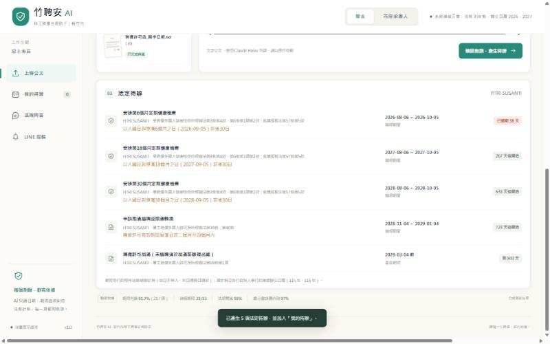
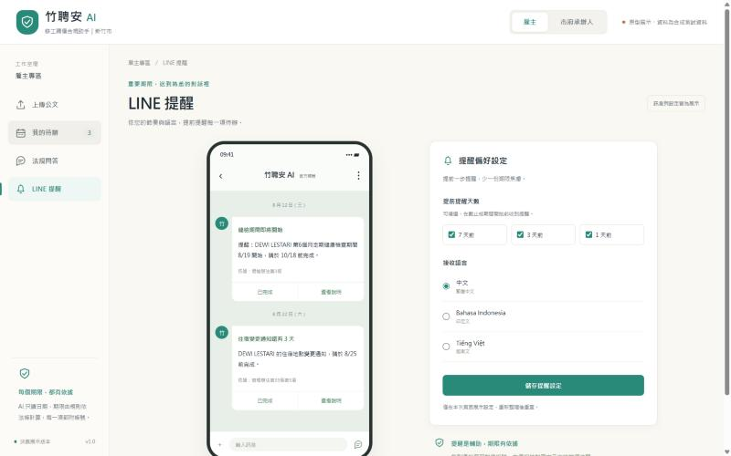
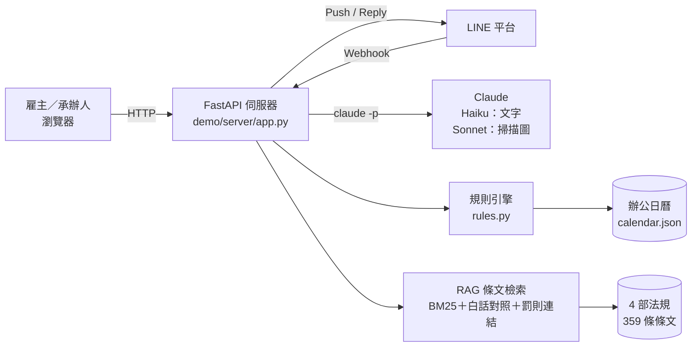

# 竹聘安 AI — 移工聘僱合規助手

> 115 新竹政策黑客松｜主題三「政策出題，智慧城市」｜社福安居組

**同一套法規知識，協助兩端：**
讓聘僱移工的**家庭與中小企業雇主**不漏辦法定義務，也讓**市府承辦人**在處分書送出前抓出缺漏。

> ⚠️ 本系統為競賽原型。所有測試文件均為**合成資料**（標註「非真實公文」，人名、文號、地址皆虛構）；系統輸出**不構成法律意見**，個案請洽主管機關或 1955 專線。

> 🛠 **決賽開發（2026-11-15 起）**：決賽協作庫為 [z1nnz/zhupinan](https://github.com/z1nnz/zhupinan)，與原始程式庫 [Johnnnny0823/ai.zhupinan](https://github.com/Johnnnny0823/ai.zhupinan) 共用完整提交歷史。開發範圍見 [`docs/竹聘安_決賽系統開發_130人時.md`](docs/竹聘安_決賽系統開發_130人時.md)，協作規則見 [`CONTRIBUTING.md`](CONTRIBUTING.md)，啟動、測試與資料重置見 [`demo/DEVELOPMENT.md`](demo/DEVELOPMENT.md)，API 見 [`demo/API.md`](demo/API.md)。`design/concept/` 是**靜態介面草稿**，不是已實作功能。

---

## 目錄

- [為什麼做這個](#為什麼做這個)
- [核心設計：AI 只讀日期，期限交給法條](#核心設計ai-只讀日期期限交給法條)
- [RAG：法條檢索增強生成](#rag法條檢索增強生成)
- [個資保護：送 AI 前本機遮蔽](#個資保護送-ai-前本機遮蔽)
- [功能與畫面](#功能與畫面)
- [驗證成果](#驗證成果)
- [快速開始](#快速開始)
- [操作流程](#操作流程)
- [LINE 推播串接](#line-推播串接)
- [系統架構與專案結構](#系統架構與專案結構)
- [重現驗證](#重現驗證)
- [法規與資料來源](#法規與資料來源)
- [限制](#限制)

---

## 為什麼做這個

聘僱一位移工，雇主要記住一連串有期限的法定義務：入國後 3 日內通報、15 日內申請聘僱許可、3 個工作日內健檢、第 6／18／30 個月定期健檢、搬宿舍 7 日內通報、許可屆滿前 2～4 個月申請續聘……

- **雇主端**：義務散落在核准函、聘僱許可、生活照顧服務計畫書裡，漏辦就會被罰（例如失聯未於 3 日內通報，罰新臺幣 3 萬至 15 萬元）。
- **市府端**：處分書除了法條，還要有具體事實、陳述意見、救濟教示等法定要件；漏寫一項，雇主提起訴願就可能被撤銷。

兩端讀的是同一套法規，卻各自靠記憶與經驗。

## 核心設計：AI 只讀日期，期限交給法條

```
公文（圖片 / PDF / 文字）
   │
   ▼
① AI 抽取 ── 只讀出姓名、入國日、許可期間等「日期欄位」，並附上公文原文片段
   │
   ▼
② 雇主確認 ── 國字日期、掃描件會標黃色「請再確認」
   │
   ▼
③ 規則引擎 ── 依法條計算 11 種法定期限（含失聯通報、遞補），每一項都附條號
   │           （行政程序法第48條：始日不算入、末日遇假日順延；
   │             國定假日依行政院人事行政總處辦公日曆）
   ▼
④ 待辦清單 ＋ LINE 提醒（中文 / 印尼文 / 越南文）
```

**為什麼不讓 AI 直接算期限？** 我們實測過：讓 AI 自己算，217 個期限只對 **8.8%**；遇到連假，**0/33**。AI 擅長「讀」，不擅長「算」——所以讓它只做擅長的事。

## RAG：法條檢索增強生成

### 各功能採用的方法

| 功能 | 是否使用 RAG | 做法 |
|---|---|---|
| **法規問答** | ✅ 檢索式 RAG | 提問 → 從 4 部法規 359 條條文檢索最相關的約 6 條 → 連同問題交給 AI → AI 只能依據這些條文回答，並附引用原文 |
| **處分書檢核** | ✅ 固定參考條文 | 每次固定附上 12 條相關條文（就業服務法第46、56、57、63、67、68條；行政程序法第96、102、103條；訴願法第4、14、58條），無需檢索 |
| **公文期限判讀** | ❌ 不需要 | AI 只抽取日期，期限由規則引擎依法條計算——此處規則比 RAG 更可靠 |

### 檢索怎麼做

```
使用者提問：「工廠要把移工搬到新宿舍，搬完多久要通知？」
   │
   ▼
① 白話 → 法律用語對照     「搬」「宿舍」→ 住宿地點 變更 生活照顧服務計畫書
   │                       「失聯」→ 連續曠職三日失去聯繫
   │                       「罰多少」→ 罰鍰 處 新臺幣 …
   ▼
② BM25 關鍵字檢索          以中文二字詞（bigram）比對 359 條條文，取前 6 條
   │
   ▼
③ 罰則連結                 問到罰則時，若檢索到第56條，自動補上引用它的罰則第68條
   │
   ▼
④ 嚴格引用生成             每個數字、期限、罰則都必須對應一條參考條文；
                           不同條文的罰則不可混用；條文沒有的直接說「未涵蓋」
```

程式：[`validation/scripts/qa.py`](validation/scripts/qa.py)（`Retriever2`、`SYS_STRICT`）

### 效果

| 方法 | 法規問答 30 題 | 10 題保留題 | 混用罰則 |
|---|---|---|---|
| 不用 RAG（AI 直接回答） | 17% | 30% | 4 題 |
| 第一版 RAG（BM25） | 73% | 90% | 1 題 |
| 改良 RAG（＋白話對照＋罰則連結） | 93% | 100% | 1 題 |
| **改良 RAG＋嚴格引用（現行版本）** | **97%** | **100%** | **0 題** |

不用 RAG 時，AI 會編造不存在的法規名稱（如「外籍家庭看護工管理辦法」）與錯誤天數；檢索命中率由 23/30 提升到 28/30。保留題是在檢索改良**完成後**才撰寫、從未用於調整，用來確認改良不是只對原題目有效。

### 為什麼不用向量資料庫？

1. **資料量小**：359 條條文，關鍵字檢索已達 28/30（保留題 10/10）命中率；向量檢索的優勢在數萬份文件時才明顯
2. **法條用語固定**：法律文字精確（「連續曠職三日」就是這幾個字），關鍵字比對比語意相似度更不易抓錯條文
3. **可解釋**：能清楚說明「為什麼找到這一條」，符合公部門對 AI 可稽核的要求

**擴充計畫**：當資料納入勞動部函釋、訴願決定書、法院判決等上萬份、寫法多樣的文件時，改採「關鍵字＋向量」混合檢索。

## 個資保護：送 AI 前本機遮蔽

依行政院〈公部門使用生成式 AI 參考指引〉「不得向生成式 AI 提供個人資料」，所有文字在送給 AI **之前**先在本機處理（[`validation/scripts/privacy.py`](validation/scripts/privacy.py)）：

| 個資 | 處理方式 |
|---|---|
| 移工姓名 | 改成代號 `PERSON_01`，AI 回答後在本機換回真名（系統需要姓名把期限對到人） |
| 身分證／居留證號、護照號碼、統一編號 | 直接遮蔽為「〔…已遮蔽〕」 |
| 出生日期、地址、電話、受處分人姓名 | 直接遮蔽；公司名稱保留（非個人資料） |
| 入國日、許可期間等判讀所需日期 | **保留** |

**驗證**（合成資料）：

- 洩漏測試：77 份純文字文件、266 筆個資，**0 筆洩漏**；關鍵日期與條文 0 行被誤遮（[`results/privacy_leak_test.md`](validation/results/privacy_leak_test.md)）
- 遮蔽後重跑：純文字公文期限 133/133、連假期限 33/33（與遮蔽前同為 100%）；處分書缺漏偵測 30/30（遮蔽前 29/30）——**準確度未下降**
- 處分書檢核畫面可展開「實際送給 AI 的內容」，承辦人可自行查核

**限制**：掃描圖片是像素，無法在本機先遮蔽，畫面會提示改傳 PDF／文字檔；公部門正式版建議改用地端或國內模型。

**資料不向市府索取**：資料由雇主上傳自己持有的公文，市府只接收去識別化的彙總統計。

## 功能與畫面

| 角色 | 功能 | 說明 |
|---|---|---|
| 雇主 | **上傳公文** | 上傳聘僱許可函、入國通報證明、住宿變更表等，AI 讀出日期，確認後產生附條號的法定待辦 |
| 雇主 | **失聯應變** | 移工連續曠職失聯時，登錄失聯日即產生：3 日內書面通報期限、遞補可申請期間（逾期不予許可）、就業安定費停繳說明，以及合法的失聯預防建議（不得扣留證件） |
| 雇主 | **我的待辦** | 所有移工的期限總覽，逾期／30 天內一目了然 |
| 雇主／仲介 | **辦理證明核對** | 每項待辦可「委任仲介」；辦完上傳證明（健檢報告、收件回執…），AI 讀出完成日期，**由規則判定準時／逾期**，雇主看得到仲介是否真的辦好 |
| 雇主 | **LINE 提醒** | 期限快到時推播到 LINE；登入取得配對碼，綁定後傳「待辦」只查該雇主案件 |
| 雙方 | **法規問答** | 用白話提問，先從 4 部法規 359 條條文找依據再回答，附引用條文原文 |
| 承辦人 | **處分書檢核** | 貼上裁處書草稿，逐項檢查七項法定要件，顯示來源片段與建議補查方向；**是否裁罰、如何裁量由承辦人決定** |

<table>
<tr>
<td><br>雇主：上傳公文、核對 AI 讀到的日期</td>
<td><br>依法條產生的待辦（實際運作畫面）</td>
</tr>
<tr>
<td><br>LINE 提醒</td>
<td><br>承辦人：處分書七項要件檢核（實際運作畫面）</td>
</tr>
</table>

## 驗證成果

完整方法、逐題明細與限制見 [validation/驗證報告.md](validation/驗證報告.md)。

| 測試 | 規模 | 只靠 AI | **竹聘安** |
|---|---|---|---|
| 公文期限判讀 | 50 份合成公文、65 位移工、217 個期限（含 15 份掃描圖） | 8.8% | **91.7%**（純文字 100%） |
| 期限遇連假 | 12 份、33 個期限（春節、清明、端午、中秋、光復節、補假） | 0% | **100%** |
| 法規問答 | 30 題＋10 題未參與調整的保留題 | 17% | **97%**（保留題 10/10），罰則混用 0 題 |
| 處分書缺漏偵測 | 30 份草稿、埋入 30 個缺漏 | — | **抓到 29 個（97%）**，警示準確率 71% |

標準答案以**全國法規資料庫條文原文**為準，由程式自動比對，**尚未經律師或承辦人審閱**。

## 決賽版本啟動與驗收（2026-11-15）

本輪交接：[已完成任務與證據](demo/COMPLETED_TASKS.md) · [尚未完成的驗證](demo/PENDING_VALIDATION.md)。實機驗收依使用者安排稍後補。

本分支按 S00–S10 工作包實作：SQLite、Session、案件隔離、文件人工確認、證明人工完成、指定帳號LINE及PWA公開離線頁。
只供合成示範，不能宣稱已可正式試辦。上方原始產品截圖與歷史基準分數仍作基線參考。

1. 安裝Python 3.12，建立venv並安裝 `demo/requirements.lock.txt`。
2. 複製 `demo/.env.example` 為 `demo/.env`，填三個不同的一次性登入碼。
3. 在倉庫根目錄執行 `python -m demo.run seed`，再 `python -m demo.run serve`。
4. 開啟 <http://127.0.0.1:8765/>，以雇主或承辦人示範帳號登入。

完整Windows／macOS啟動、環境變數、模型備援、LINE每日排程、重置與遷移：
[demo/DEVELOPMENT.md](demo/DEVELOPMENT.md)。API範例見[demo/API.md](demo/API.md)。
驗收結果及未完成項目見[demo/ACCEPTANCE.md](demo/ACCEPTANCE.md)；現場路線見[demo/DEMO_SCRIPT.md](demo/DEMO_SCRIPT.md)。

共同開發規則（分支、PR、協作者、給 Claude Code／Codex 的說明）見 [CONTRIBUTING.md](CONTRIBUTING.md)、[AI_WORKFLOW.md](AI_WORKFLOW.md)。

雇主流程：選合成文件 → 逐欄修改／確認 → 查看待辦法源與計算 → 官方入口辦理 → 上傳證明 → 雇主核對完成。
LINE必須先取得一次性配對碼並在指定對話輸入，只寄該雇主案件；不向所有好友群發。
「聯絡確認」以實際應工作日與可核實聯絡事實提供指引，不自動判定行蹤不明。
承辦人另用officer帳號登入，七項檢核僅提示可能缺漏與補查方向，不讀雇主案件。

## 系統架構與專案結構



```
.
├── 啟動DEMO.bat              # Windows 一鍵啟動
├── demo/
│   ├── server/
│   │   ├── app.py            # API：抽取、待辦、問答、處分書檢核、LINE
│   │   ├── llm.py            # Claude CLI 呼叫，提示暫存隨後刪除
│   │   └── line.env.example  # LINE 金鑰範本
│   ├── web/                  # 前端（index.html / app.js / 範例公文）
│   ├── mockup/               # Codex 產生的介面原型與預覽圖
│   ├── LINE串接教學.md
│   └── requirements.txt
└── validation/
    ├── 驗證報告.md            # 驗證方法、結果與限制
    ├── laws/                 # 法規條文全文、辦公日曆（JSON）
    ├── scripts/
    │   ├── rules.py          # 期限規則引擎（每條規則附條號）
    │   ├── gen_docs.py       # 產生 50 份合成公文與標準答案
    │   ├── gen_holiday.py    # 產生 12 份連假測試公文
    │   ├── extract.py        # 公文判讀測試
    │   ├── qa.py             # 法規問答測試（含檢索）
    │   ├── penalty.py        # 處分書檢核測試
    │   └── score.py          # 評分
    ├── docs/ docs_holiday/ penalty/   # 合成測試資料
    ├── runs/                 # 各次測試的 AI 原始輸出
    └── results/              # 評分結果
```

**DEMO 與驗證使用同一套程式**：`demo/server/app.py` 直接匯入 `validation/scripts/` 的規則引擎、檢索與檢核模組，展示畫面與測試數字出自同一份程式碼。

## 重現驗證

```bash
cd validation/scripts
python gen_docs.py                                  # 產生合成公文（已附於 repo）
python extract.py --model haiku --mode extract      # 竹聘安做法
python extract.py --model haiku --mode llm_only     # 對照組：AI 自己算期限
python score.py extract_haiku llm_only_haiku

python qa.py run --cond rag2s && python qa.py score
python penalty.py run && python penalty.py score
```

已跑過的結果快取在 `validation/runs/`，重跑時會自動略過。

## 法規與資料來源

| 來源 | 用途 |
|---|---|
| 全國法規資料庫：就業服務法、雇主聘僱外國人許可及管理辦法、受聘僱外國人健康檢查管理辦法、行政程序法、訴願法 | 規則引擎、法規問答、處分書檢核 |
| 政府資料開放平臺 dataset 14718：行政院人事行政總處《政府行政機關辦公日曆表》115、116 年 | 國定假日與補假順延 |
| 勞動部新聞稿（2015-09-08）勞工行政訴願統計 | 問題界定 |

法規版本以 2026-11-12 下載之全國法規資料庫為準。

## 限制

- 測試資料為合成資料，真實公文的版面、手寫、印章、多頁 PDF 尚未大規模測試
- 標準答案以法條原文自動比對，未經律師或承辦人逐題審閱
- 辦公日曆目前涵蓋 2026、2027 年；release API對其他年份回「需人工確認」，不公開推測期限
- 「期滿續聘後定期健檢自新許可生效日起算」為依條文推定
- 印尼文、越南文提醒為翻譯草稿，正式使用前需母語人士審閱
- AI 呼叫透過本機 Claude CLI，需保持登入與網路連線

## 團隊

115 新竹政策黑客松 竹聘安團隊（企管系 × 資管系）
