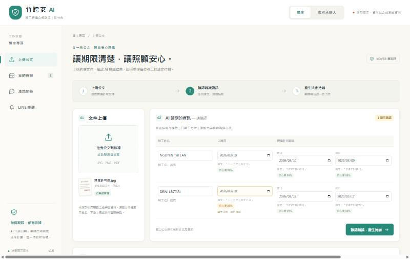
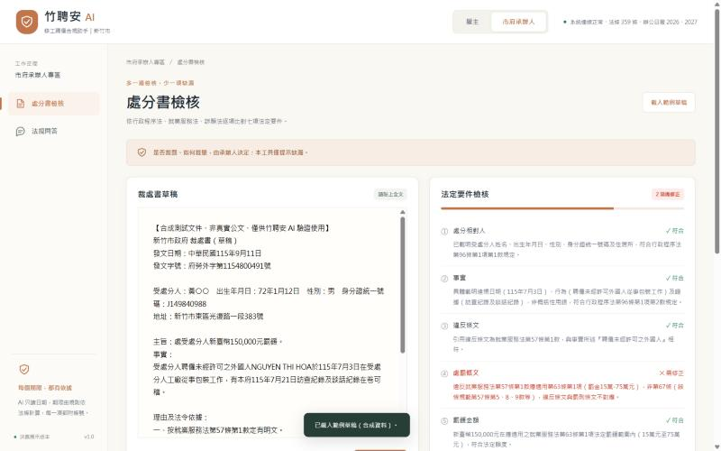
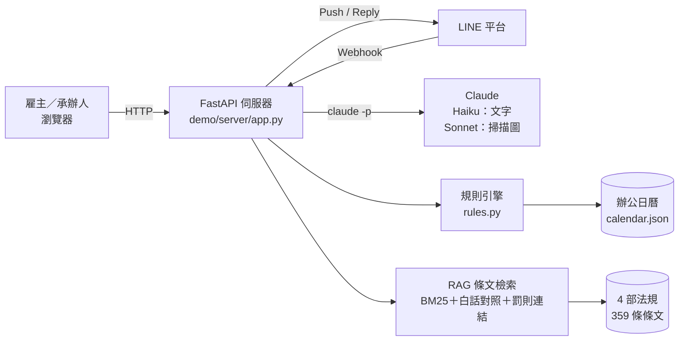

# 竹聘安 AI — 移工聘僱合規助手

> 115 新竹政策黑客松｜主題三「政策出題，智慧城市」｜社福安居組

**同一套法規知識，協助兩端：**
讓聘僱移工的**家庭與中小企業雇主**不漏辦法定義務，也讓**市府承辦人**在處分書送出前抓出缺漏。

> ⚠️ 本系統為競賽原型。所有測試文件均為**合成資料**（標註「非真實公文」，人名、文號、地址皆虛構）；系統輸出**不構成法律意見**，個案請洽主管機關或 1955 專線。

---

## 目錄

- [為什麼做這個](#為什麼做這個)
- [核心設計：AI 只讀日期，期限交給法條](#核心設計ai-只讀日期期限交給法條)
- [RAG：法條檢索增強生成](#rag法條檢索增強生成)
- [功能與畫面](#功能與畫面)
- [驗證成果](#驗證成果)
- [快速開始](#快速開始)
- [操作流程](#操作流程)
- [LINE 推播串接](#line-推播串接)
- [系統架構與專案結構](#系統架構與專案結構)
- [重現驗證](#重現驗證)
- [法規與資料來源](#法規與資料來源)
- [限制](#限制)

---

## 為什麼做這個

聘僱一位移工，雇主要記住一連串有期限的法定義務：入國後 3 日內通報、15 日內申請聘僱許可、3 個工作日內健檢、第 6／18／30 個月定期健檢、搬宿舍 7 日內通報、許可屆滿前 2～4 個月申請續聘……

- **雇主端**：義務散落在核准函、聘僱許可、生活照顧服務計畫書裡，漏辦就會被罰（例如失聯未於 3 日內通報，罰新臺幣 3 萬至 15 萬元）。
- **市府端**：處分書除了法條，還要有具體事實、陳述意見、救濟教示等法定要件；漏寫一項，雇主提起訴願就可能被撤銷。

兩端讀的是同一套法規，卻各自靠記憶與經驗。

## 核心設計：AI 只讀日期，期限交給法條

```
公文（圖片 / PDF / 文字）
   │
   ▼
① AI 抽取 ── 只讀出姓名、入國日、許可期間等「日期欄位」，並附上公文原文片段
   │
   ▼
② 雇主確認 ── 國字日期、掃描件會標黃色「請再確認」
   │
   ▼
③ 規則引擎 ── 依法條計算 9 種法定期限，每一項都附條號
   │           （行政程序法第48條：始日不算入、末日遇假日順延；
   │             國定假日依行政院人事行政總處辦公日曆）
   ▼
④ 待辦清單 ＋ LINE 提醒（中文 / 印尼文 / 越南文）
```

**為什麼不讓 AI 直接算期限？** 我們實測過：讓 AI 自己算，217 個期限只對 **8.8%**；遇到連假，**0/33**。AI 擅長「讀」，不擅長「算」——所以讓它只做擅長的事。

## RAG：法條檢索增強生成

### 各功能採用的方法

| 功能 | 是否使用 RAG | 做法 |
|---|---|---|
| **法規問答** | ✅ 檢索式 RAG | 提問 → 從 4 部法規 359 條條文檢索最相關的約 6 條 → 連同問題交給 AI → AI 只能依據這些條文回答，並附引用原文 |
| **處分書檢核** | ✅ 固定參考條文 | 每次固定附上 12 條相關條文（就業服務法第46、56、57、63、67、68條；行政程序法第96、102、103條；訴願法第4、14、58條），無需檢索 |
| **公文期限判讀** | ❌ 不需要 | AI 只抽取日期，期限由規則引擎依法條計算——此處規則比 RAG 更可靠 |

### 檢索怎麼做

```
使用者提問：「工廠要把移工搬到新宿舍，搬完多久要通知？」
   │
   ▼
① 白話 → 法律用語對照     「搬」「宿舍」→ 住宿地點 變更 生活照顧服務計畫書
   │                       「失聯」→ 連續曠職三日失去聯繫
   │                       「罰多少」→ 罰鍰 處 新臺幣 …
   ▼
② BM25 關鍵字檢索          以中文二字詞（bigram）比對 359 條條文，取前 6 條
   │
   ▼
③ 罰則連結                 問到罰則時，若檢索到第56條，自動補上引用它的罰則第68條
   │
   ▼
④ 嚴格引用生成             每個數字、期限、罰則都必須對應一條參考條文；
                           不同條文的罰則不可混用；條文沒有的直接說「未涵蓋」
```

程式：[`validation/scripts/qa.py`](validation/scripts/qa.py)（`Retriever2`、`SYS_STRICT`）

### 效果

| 方法 | 法規問答 30 題 | 10 題保留題 | 混用罰則 |
|---|---|---|---|
| 不用 RAG（AI 直接回答） | 17% | 30% | 4 題 |
| 第一版 RAG（BM25） | 73% | 90% | 1 題 |
| 改良 RAG（＋白話對照＋罰則連結） | 93% | 100% | 1 題 |
| **改良 RAG＋嚴格引用（現行版本）** | **97%** | **100%** | **0 題** |

不用 RAG 時，AI 會編造不存在的法規名稱（如「外籍家庭看護工管理辦法」）與錯誤天數；檢索命中率由 23/30 提升到 28/30。保留題是在檢索改良**完成後**才撰寫、從未用於調整，用來確認改良不是只對原題目有效。

### 為什麼不用向量資料庫？

1. **資料量小**：359 條條文，關鍵字檢索已達 28/30（保留題 10/10）命中率；向量檢索的優勢在數萬份文件時才明顯
2. **法條用語固定**：法律文字精確（「連續曠職三日」就是這幾個字），關鍵字比對比語意相似度更不易抓錯條文
3. **可解釋**：能清楚說明「為什麼找到這一條」，符合公部門對 AI 可稽核的要求

**擴充計畫**：當資料納入勞動部函釋、訴願決定書、法院判決等上萬份、寫法多樣的文件時，改採「關鍵字＋向量」混合檢索。

## 功能與畫面

| 角色 | 功能 | 說明 |
|---|---|---|
| 雇主 | **上傳公文** | 上傳聘僱許可函、入國通報證明、住宿變更表等，AI 讀出日期，確認後產生附條號的法定待辦 |
| 雇主 | **我的待辦** | 所有移工的期限總覽，逾期／30 天內一目了然 |
| 雇主 | **LINE 提醒** | 期限快到時推播到 LINE；加好友傳「待辦」即可查詢 |
| 雙方 | **法規問答** | 用白話提問，先從 4 部法規 359 條條文找依據再回答，附引用條文原文 |
| 承辦人 | **處分書檢核** | 貼上裁處書草稿，逐項檢查七項法定要件，提供可直接貼上的修正文字；**是否裁罰、如何裁量由承辦人決定** |

<table>
<tr>
<td><br>雇主：上傳公文、核對 AI 讀到的日期</td>
<td><br>依法條產生的待辦（實際運作畫面）</td>
</tr>
<tr>
<td><br>LINE 提醒</td>
<td><br>承辦人：處分書七項要件檢核（實際運作畫面）</td>
</tr>
</table>

## 驗證成果

完整方法、逐題明細與限制見 [validation/驗證報告.md](validation/驗證報告.md)。

| 測試 | 規模 | 只靠 AI | **竹聘安** |
|---|---|---|---|
| 公文期限判讀 | 50 份合成公文、65 位移工、217 個期限（含 15 份掃描圖） | 8.8% | **91.7%**（純文字 100%） |
| 期限遇連假 | 12 份、33 個期限（春節、清明、端午、中秋、光復節、補假） | 0% | **100%** |
| 法規問答 | 30 題＋10 題未參與調整的保留題 | 17% | **97%**（保留題 10/10），罰則混用 0 題 |
| 處分書缺漏偵測 | 30 份草稿、埋入 30 個缺漏 | — | **抓到 29 個（97%）**，警示準確率 71% |

標準答案以**全國法規資料庫條文原文**為準，由程式自動比對，**尚未經律師或承辦人審閱**。

## 快速開始

### 需求

- Windows 10/11（其他系統亦可，啟動指令略有不同）
- Python 3.12
- [Claude Code CLI](https://docs.anthropic.com/claude-code)，並已登入（系統透過 `claude -p` 呼叫 AI，使用登入帳號的額度）

### 安裝

```bash
git clone https://github.com/Johnnnny0823/ai.zhupinan.git
cd ai.zhupinan
pip install -r demo/requirements.txt
claude auth login
```

### 啟動

Windows：雙擊專案根目錄的 **`啟動DEMO.bat`**，瀏覽器會自動開啟 <http://localhost:8765>。

或手動執行（任何系統）：

```bash
python -m uvicorn app:app --app-dir demo/server --host 127.0.0.1 --port 8765
```

看到 `Uvicorn running on http://127.0.0.1:8765` 即啟動成功。右上角顯示「系統連線正常・法條 359 條・辦公日曆 2026、2027」代表一切就緒。

## 操作流程

### 雇主：從公文到 LINE 提醒

1. 右上角選「**雇主**」，左側選「**上傳公文**」
2. 拖曳公文到上傳區，或點選範例公文
   - `★ 昨天剛入國的移工`、`★ 前天搬宿舍`：依今天日期即時產生，期限就在這幾天，適合現場展示 LINE 推播
   - 其他範例：國字日期、掃描圖片、遇春節連假等
3. 等 AI 讀完（文字約 10 秒、圖片約 30 秒），核對「AI 讀到的資訊」：
   - 每個日期下方附**公文原文**，可直接修改
   - 黃色標示＝國字日期或掃描件，請特別核對
4. 按右下角「**確認無誤，產生待辦**」
   - 下方出現法定待辦，每項附**條號與辦理期限**；遇假日順延會註明原因
   - 同一份公文重複確認不會重複新增
5. 左側「**我的待辦**」：查看所有移工的期限，可篩選 30 天內／已逾期
6. 左側「**LINE 提醒**」：選提醒範圍與語言 → 按「**產生提醒並推播**」
   - 未設定 LINE 時顯示手機預覽；設定後實際推播（一次一則，條列所有待辦）

### 法規問答

1. 左側「**法規問答**」
2. 點常見問題或自行輸入，例如「搬宿舍後多久要通知？」
3. 回答附**引用條文原文**（可展開），每個數字都對應到一條條文

### 市府承辦人：處分書檢核

1. 右上角切換為「**市府承辦人**」
2. 「**處分書檢核**」→ 貼上裁處書草稿，或按「載入範例草稿」
3. 按「**檢核草稿**」（約 20～40 秒）
4. 右側顯示七項要件逐項結果與理由：
   ① 處分相對人 ② 事實 ③ 違反條文 ④ 處罰條文對應 ⑤ 罰鍰在法定範圍 ⑥ 陳述意見 ⑦ 救濟教示
5. 「建議補充／修正文字」可一鍵複製；**是否採用由承辦人判斷**

## LINE 推播串接

逐步教學（含申請官方帳號、取得金鑰、設定 Webhook、常見問題）：[demo/LINE串接教學.md](demo/LINE串接教學.md)

重點：
- 金鑰寫在 `demo/server/line.env`（參考 [`line.env.example`](demo/server/line.env.example)），**此檔已列入 `.gitignore`，切勿提交**
- Webhook 以 HMAC-SHA256 驗證 LINE 簽章，偽造請求一律拒絕
- 好友名單只存 LINE 提供的匿名 userId

## 系統架構與專案結構



```
.
├── 啟動DEMO.bat              # Windows 一鍵啟動
├── demo/
│   ├── server/
│   │   ├── app.py            # API：抽取、待辦、問答、處分書檢核、LINE
│   │   ├── llm.py            # Claude CLI 呼叫與快取
│   │   └── line.env.example  # LINE 金鑰範本
│   ├── web/                  # 前端（index.html / app.js / 範例公文）
│   ├── mockup/               # Codex 產生的介面原型與預覽圖
│   ├── LINE串接教學.md
│   └── requirements.txt
└── validation/
    ├── 驗證報告.md            # 驗證方法、結果與限制
    ├── laws/                 # 法規條文全文、辦公日曆（JSON）
    ├── scripts/
    │   ├── rules.py          # 期限規則引擎（每條規則附條號）
    │   ├── gen_docs.py       # 產生 50 份合成公文與標準答案
    │   ├── gen_holiday.py    # 產生 12 份連假測試公文
    │   ├── extract.py        # 公文判讀測試
    │   ├── qa.py             # 法規問答測試（含檢索）
    │   ├── penalty.py        # 處分書檢核測試
    │   └── score.py          # 評分
    ├── docs/ docs_holiday/ penalty/   # 合成測試資料
    ├── runs/                 # 各次測試的 AI 原始輸出
    └── results/              # 評分結果
```

**DEMO 與驗證使用同一套程式**：`demo/server/app.py` 直接匯入 `validation/scripts/` 的規則引擎、檢索與檢核模組，展示畫面與測試數字出自同一份程式碼。

## 重現驗證

```bash
cd validation/scripts
python gen_docs.py                                  # 產生合成公文（已附於 repo）
python extract.py --model haiku --mode extract      # 竹聘安做法
python extract.py --model haiku --mode llm_only     # 對照組：AI 自己算期限
python score.py extract_haiku llm_only_haiku

python qa.py run --cond rag2s && python qa.py score
python penalty.py run && python penalty.py score
```

已跑過的結果快取在 `validation/runs/`，重跑時會自動略過。

## 法規與資料來源

| 來源 | 用途 |
|---|---|
| 全國法規資料庫：就業服務法、雇主聘僱外國人許可及管理辦法、受聘僱外國人健康檢查管理辦法、行政程序法、訴願法 | 規則引擎、法規問答、處分書檢核 |
| 政府資料開放平臺 dataset 14718：行政院人事行政總處《政府行政機關辦公日曆表》115、116 年 | 國定假日與補假順延 |
| 勞動部新聞稿（2015-09-08）勞工行政訴願統計 | 問題界定 |

法規版本以 2026-11-12 下載之全國法規資料庫為準。

## 限制

- 測試資料為合成資料，真實公文的版面、手寫、印章、多頁 PDF 尚未大規模測試
- 標準答案以法條原文自動比對，未經律師或承辦人逐題審閱
- 辦公日曆目前涵蓋 2026、2027 年；其他年份僅以週末判斷並提示確認
- 「期滿續聘後定期健檢自新許可生效日起算」為依條文推定
- 印尼文、越南文提醒為翻譯草稿，正式使用前需母語人士審閱
- AI 呼叫透過本機 Claude CLI，需保持登入與網路連線

## 團隊

115 新竹政策黑客松 竹聘安團隊（企管系 × 資管系）
