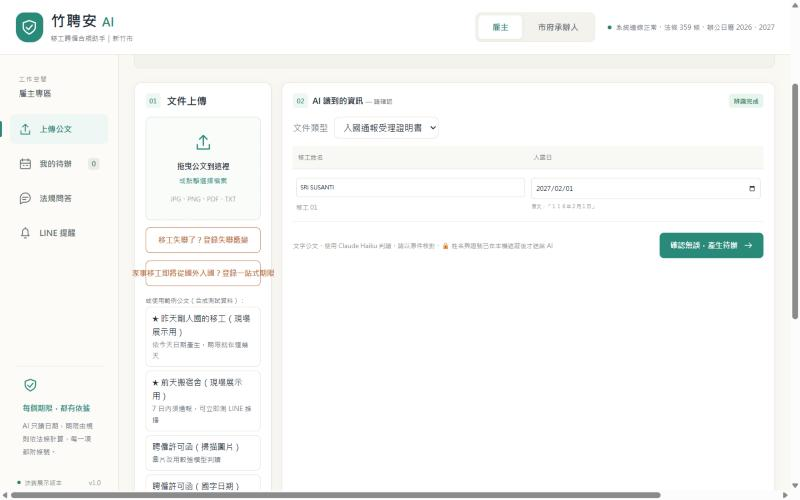
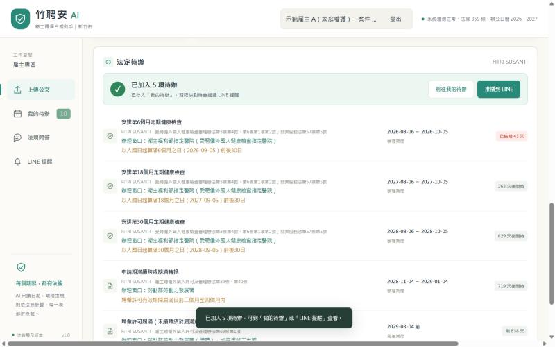
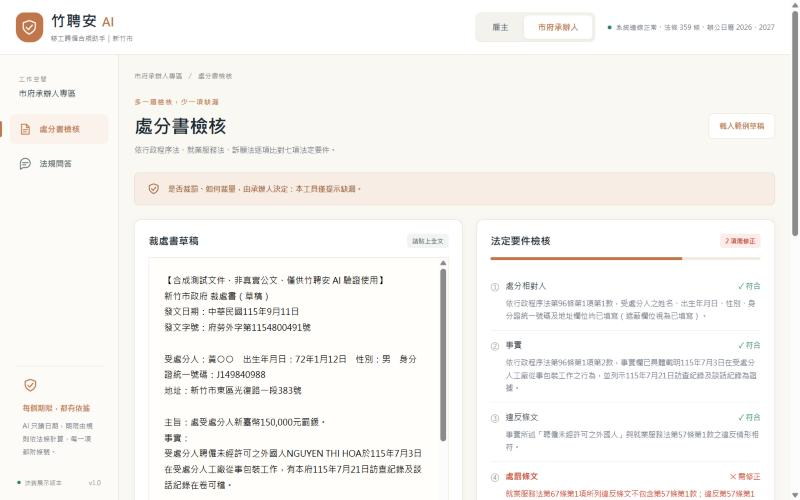

# 竹聘安 AI｜移工聘僱合規助手

> 115 年新竹政策黑客松 · 政策出題，智慧城市 · 社福安居組

竹聘安協助聘僱移工的**家庭及產業雇主**，把許可函、通報證明等文件整理成有法源、期限和辦理入口的待辦清單。系統也提供**市府承辦人**獨立的工作區，檢查處分書草稿的記載是否完整。

這是使用合成資料的**競賽決賽示範系統**。請使用內建範例操作，示範結果僅供理解系統流程。實際案件的期限與處分仍須由當事人或主管機關確認。

## 雇主端｜從文件到待辦

1. **選擇合成公文**。使用範例聘僱許可函等文件，擷取姓名、入國日或許可期間等欄位及原文片段。文字 PDF 依頁整理後再擷取；內建合成掃描圖先經本機 OCR，再以遮蔽後的文字擷取。
2. **核對擷取欄位**。雇主逐欄確認日期，必要時修正，再確認建立待辦。
3. **查看辦理期限**。待辦顯示適用條文、計算過程和官方辦理入口。資料或日曆不足時，顯示「需人工確認」。
4. **核對辦理證明**。上傳合成證明後，由雇主確認完成日期。系統依規則記錄準時或逾期，並保留對應待辦。
5. **查詢及提醒**。雇主可以查詢適用法規、依應工作日整理聯絡事實，也可在配置 LINE 後綁定帳號，在期限前 30、14、7、3 天及當天接收提醒，或輸入「待辦」查詢未來 30 天內的事項。

## 承辦人端｜處分書草稿檢核

承辦人以獨立的示範帳號登入，選擇合成草稿後查看七項檢核結果。畫面列出草稿中的來源片段、相關條文及補查方向，供承辦人確認缺漏、補充事實及決定後續處理。草稿檢核權限與雇主案件分開，承辦人不能開啟雇主的文件、待辦與證明。

<table>
<tr>
<td width="50%"><br>雇主核對文件日期</td>
<td width="50%"><br>確認後建立有法源的待辦</td>
</tr>
<tr>
<td colspan="2"><br>承辦人檢視處分書草稿的要件及補查方向</td>
</tr>
</table>

以上為本機合成資料展示畫面。

## 系統怎麼運作

| 元件 | 職責 |
| --- | --- |
| 文件擷取 | 即時模式由模型讀取必要欄位及證據片段。預存模式以內建範例重現相同的人工核對流程。 |
| 期限規則引擎 | 根據使用者已確認的資料、適用條文與辦公日曆計算期限，並附上日期來源及計算步驟。 |
| 法規問答 | 用 BM25、白話詞彙對照及罰則關聯檢索相關條文。雇主可使用已確認個案資料，問答顯示參考條文。 |
| 網頁與資料 | 原生 HTML、CSS、JavaScript 搭配 FastAPI、Pydantic 及 SQLite。網頁依登入角色呈現功能，API 逐次檢查身分與案件歸屬。 |

期限計算、問答與草稿檢核共用 `validation/scripts/` 下的規則及檢索模組。法規版本、2026／2027 辦公日曆及官方辦理入口可查閱 [資料來源紀錄](demo/LEGAL_SOURCES.md)。歷史對照實驗與評分方式見 [驗證報告](validation/驗證報告.md)。

## 資安與隱私保護

| 防護 | 實作 |
| --- | --- |
| 一次性登入及限流 | 示範登入碼使用後失效。服務依帳號與 ASGI 連線來源限制錯誤嘗試，另設帳號跨來源總額。本機啟動器停用代理標頭，以免客戶端自填來源影響計數。 |
| 角色和案件隔離 | 雇主只能讀取及修改自己案件、待辦及證明，承辦端只使用獨立草稿檢核與法規問答。寫入 API 檢查 Origin，案件 API 回應停用快取。 |
| 上傳資料最小化 | 原件及預覽不作持久化保存。文字在送模型前於本機遮蔽，只有經過雜湊比對的內建合成掃描圖會進行本機 OCR。模型只接收遮蔽後的文字。確認草稿暫存必要欄位並定時失效。 |
| LINE 帳號隔離 | 一次性配對碼將 LINE 使用者與雇主帳號綁定。Webhook 驗證簽章，查詢及通知限定該雇主的待辦。 |

見 [登入與限流](demo/server/auth.py)、[API 與授權](demo/API.md)、[上傳處理](demo/server/storage.py)、[文字遮蔽](validation/scripts/privacy.py) 和 [LINE 通知](demo/server/notifications.py)。

## 本機展示

需要 Python 3.12。以下指令從專案根目錄執行。

```powershell
py -3.12 -m venv .venv
.venv\Scripts\python -m pip install -r demo/requirements.lock.txt
Copy-Item demo/.env.example demo/.env
```

在 `demo/.env` 保留 `DEMO_DATA=true`，將三個示範登入碼改成各不相同且至少 8 字元的值，再初始化資料與啟動服務。

```powershell
.venv\Scripts\python -m demo.run seed
.venv\Scripts\python -m demo.run serve
```

- **完整展示**請開啟 <http://127.0.0.1:8765/>，以 `employer-a`、`employer-b` 或 `officer` 登入。登入碼已使用時，可在另一個終端執行 `.venv\Scripts\python -m demo.run codes` 重新啟用。
- **預存展示**可在文件或草稿檢核中選擇預存結果。也可開啟獨立的 [無須登入展示頁](http://127.0.0.1:8765/local-demo.html)。
- **即時文件擷取與草稿檢核**依賴已登入的 Claude CLI。使用合成掃描圖的即時模式前，執行 `.venv\Scripts\python -m demo.install_ocr` 安裝並驗證本機 OCR 語言資料。LINE 需另設定頻道環境變數及 HTTPS Webhook。見 [開發環境與備援](demo/DEVELOPMENT.md)、[LINE 串接教學](demo/LINE串接教學.md)。

## 驗證範圍

- 2026-11-23 完成 **160 項本機測試**，涵蓋案件隔離、登入限流、文件核對及規則回歸，全部通過。
- **離線基準重播**使用保存的樣本，結果為假日期限 33／33、保留問答 10／10、處分書缺漏偵測 29／30。
- **純文字隱私測試**涵蓋 266 筆合成測項，回報 0 筆洩漏及 0 筆關鍵資訊誤遮。
- 兩張內建掃描已在 Windows 完成本機 OCR，其中一張另以即時模型讀出預期日期並確認仍需人工核對。LINE 排程與查詢以模擬串接測試，真機收發、政府系統介接及正式法規審查仍待驗證。

```powershell
.venv\Scripts\python -m pip install -r demo/requirements-dev.txt
.venv\Scripts\python -m pytest demo/tests -q
.venv\Scripts\python -m demo.verify_baseline
```

## 專案文件

- [展示腳本](demo/DEMO_SCRIPT.md) · [驗收紀錄](demo/ACCEPTANCE.md) · [待驗證項目](demo/PENDING_VALIDATION.md)
- [決賽開發工作包](docs/竹聘安_決賽系統開發_130人時.md) · [協作方式](CONTRIBUTING.md) · [協作倉庫](https://github.com/z1nnz/zhupinan)

115 年新竹政策黑客松竹聘安團隊（企管系 × 資管系）
